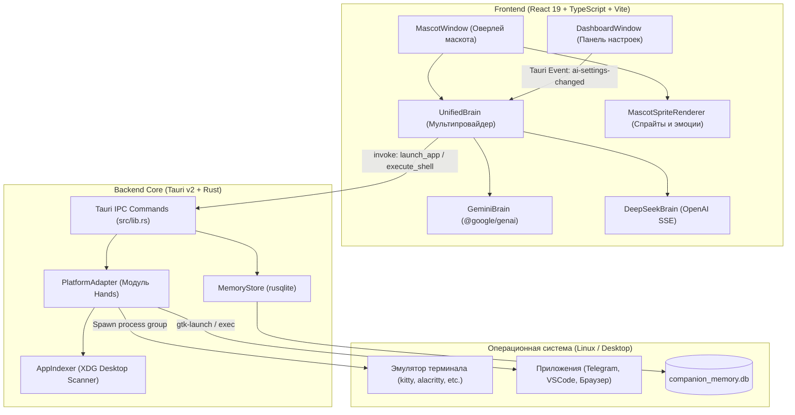

# 🤖 Capri Desktop Companion

> **Автономный интерактивный ИИ-маскот для рабочего стола** на базе **Tauri v2**, **React 19** и **Rust** с поддержкой мультипровайдерного ИИ (**Google Gemini** + **DeepSeek**), локальной долговременной памяти **SQLite** и нативным контроллером операционной системы.

[](LICENSE)
[](https://tauri.app)
[](https://react.dev)
[](https://www.typescriptlang.org)
[](https://www.rust-lang.org)
[](https://sqlite.org)

---

## 🌟 Ключевые возможности

### 1. 🎭 Интерактивный экранный маскот
- **Прозрачное окно-оверлей**: без рамок, поверх всех окон (`alwaysOnTop`), поддержка прозрачности и клик-сквозь (`click-through`).
- **Физика и взаимодействие**: перемещение мышью (drag-and-drop), гравитация, падение на край экрана и приземление на активные окна (`perch`).
- **Спрайтовый анимационный движок**:
  - Поддержка эмоциональных состояний: `idle`, `talking`, `happy`, `thinking`, `confused`, `surprised`, `angry`, `sad`.
  - Реалистичная анимация моргания и плавная артикуляция речи без артефактов ускорения.
  - Речевые облака с потоковым эффектом печатающегося текста (*typewriter stream*).
- **Кастомные аватары**: модульная загрузка аватаров через JSON-манифесты (`AvatarManager`).

### 2. 🧠 Мультипровайдерный ИИ (Multi-Provider AI Brain)
- **Единый фасад (`UnifiedBrain`)**: динамическое переключение между нейросетевыми провайдерами на лету без перезапуска приложения:
  - **Google Gemini**: поддержка `gemini-2.5-flash`, `gemini-2.5-pro`, `gemini-1.5-flash`, `gemini-1.5-pro` с настраиваемым бюджетом размышлений (*Thinking Budget*).
  - **DeepSeek**: прямое OpenAI-совместимое подключение (`https://api.deepseek.com` с возможностью указания своего прокси/шлюза), поддержка моделей `deepseek-chat` (V3) и `deepseek-reasoner` (R1 CoT).
- **Потоковый вывод мыслей (Reasoning Content)**: для модели `deepseek-reasoner` цепочка рассуждений в реальном времени транслируется в коллбэк мышления маскота.
- **Двусторонний вызов инструментов (Tool / Function Calling)**:
  - Запуск установленных приложений (`launch_app`).
  - Открытие ссылок в системном браузере (`open_url`).
  - Выполнение команд в терминале (`execute_shell`).
  - Посадка на окно (`window_perch`), снимки экрана (`capture_screen`) и установка таймеров (`set_timer`).

### 3. 🦾 Нативный системный контроллер (Hands & Platform Adapter)
- **Архитектура `PlatformAdapter`**: абстрагированный слой для взаимодействия с ОС без жесткой привязки к конкретному дистрибутиву Linux.
- **Динамический индексатор приложений (`AppIndexer`)**:
  - Фоновое сканирование системных и пользовательских каталогов XDG (`/usr/share/applications`, `~/.local/share/applications`, Flatpak).
  - Парсинг `.desktop`-файлов: локализованные имена (`Name[ru]`, `Name[en]`), категории, ключевые слова (`Keywords`), исполняемые команды (`Exec` с очисткой параметров `%u`, `%F`).
  - Кэширование в базу данных SQLite для мгновенного нечёткого поиска без захардкоженных синонимов.
  - Запуск через системный `gtk-launch` с надёжным фоллбэком на бинарники и отсоединением процесса (`process_group` / `setsid`).
- **Умное исполнение в терминале**:
  - Автоматическое определение установленного в системе терминала (`$TERMINAL`, `kitty`, `alacritty`, `wezterm`, `ghostty`, `gnome-terminal`, `konsole`, `xfce4-terminal`, `foot`, `xterm`).
  - **Персистентная консоль**: консольное окно **не закрывается** после выполнения команды (флаги `--hold` либо интерактивная оболочка `$SHELL`), позволяя пользователю видеть вывод (`nmap`, `ping`, `curl`) и продолжать работу в том же окне.
- **Безопасное открытие URL**: валидация схемы (`http://`, `https://`) и запуск через `tauri-plugin-opener` / `xdg-open`.

### 4. 💾 Долговременная память (Long-Term Memory)
- Встроенная локальная база данных **SQLite** (`companion_memory.db`).
- Сохранение фактов, пользовательских настроек, контекста диалогов и тегов.
- Автоматическая компактификация и очистка устаревших воспоминаний.

### 5. 🎛️ Панель управления (Dashboard)
- **Settings**:
  - Переключатель провайдеров ИИ (Gemini ⟷ DeepSeek).
  - Маскированные поля ввода API-ключей с кнопкой показать/скрыть и ссылками на консоли получения ключей (Google AI Studio, DeepSeek Platform).
  - Выбор модели и Base URL для DeepSeek.
  - **Test Connection**: пинг-проверка ключа с отображением задержки отклика в миллисекундах.
  - Мгновенное сохранение и применение настроек во всех окнах через события Tauri (`ai-settings-changed`).
- **Avatars**: каталог аватаров, просмотр спрайтов и предпросмотр анимаций.
- **Memory Explorer**: просмотр, поиск и редактирование записей долговременной памяти SQLite.
- **Husk Logs**: мониторинг IPC-сокета и событий фонового демона.

---

## 🏛️ Архитектура проекта



---

## 📂 Структура каталогов

```
companion/
├── public/                 # Статические ресурсы, дефолтные спрайты и иконки
│   └── avatars/            # Спрайт-листы и манифесты аватаров
├── src/                    # Фронтенд-приложение (React 19 + TypeScript)
│   ├── brain/              # Интеллект маскота и провайдеры нейросетей
│   │   ├── index.ts        # UnifiedBrain (фасад с автопереключением)
│   │   ├── gemini.ts       # Клиент Google Gemini API
│   │   ├── deepseek.ts     # Клиент DeepSeek API (SSE, Reasoner CoT, Tools)
│   │   ├── tools.ts        # Описания инструментов (Gemini & OpenAI schemas)
│   │   ├── sanitizer.ts    # Фильтрация и очистка чувствительных данных
│   │   └── system_prompt.ts# Системные инструкции для LLM
│   ├── dashboard/          # Окно настроек, памяти и аватаров (DashboardWindow)
│   ├── engine/             # Движок рендеринга спрайтов, физики и аватаров
│   ├── mascot/             # Главное окно оверлея маскота (MascotWindow)
│   ├── types/              # TypeScript интерфейсы и типы команд
│   ├── App.tsx             # Мультиоконный роутер Tauri (?window=mascot|dashboard)
│   └── main.tsx            # Точка входа React
├── src-tauri/              # Бэкенд Tauri v2 на Rust
│   ├── src/
│   │   ├── brain/          # SQLite MemoryStore для долговременной памяти
│   │   ├── hands/          # Контроллер ОС (AppIndexer, terminal, URL, system info)
│   │   ├── husk/           # Сокет-сервер фонового режима (Husk mode)
│   │   ├── ipc/            # Обработчики IPC-вызовов Tauri
│   │   ├── lib.rs          # Сборка приложения, регистрация команд и запуск
│   │   └── main.rs         # Точка входа бинарника
│   ├── Cargo.toml          # Зависимости Rust (tauri, rusqlite, tokio, etc.)
│   └── tauri.conf.json     # Конфигурация окон, оверлея и сборщика Tauri
├── package.json            # Зависимости Node.js
├── vite.config.ts          # Конфигурация Vite
└── README.md               # Документация проекта
```

---

## 🛠️ Системные требования

- **ОС**: Linux (протестировано на Arch Linux, Ubuntu, Fedora; Wayland и X11)
- **Node.js**: `>= 18.0.0`
- **npm**: `>= 9.0.0`
- **Rust**: `>= 1.80.0` (с поддержкой `edition = "2024"`)
- **Системные библиотеки Linux**:
  ```bash
  # Для систем на базе Debian/Ubuntu:
  sudo apt-get update && sudo apt-get install -y \
    libwebkit2gtk-4.1-dev \
    build-essential \
    curl \
    wget \
    file \
    libxdo-dev \
    libssl-dev \
    libayatana-appindicator3-dev \
    librsvg2-dev

  # Для Arch Linux:
  sudo pacman -S --needed \
    webkit2gtk-4.1 \
    base-devel \
    curl \
    wget \
    file \
    openssl
  ```

---

## 🚀 Установка и запуск

### 1. Клонирование репозитория
```bash
git clone https://github.com/your-username/companion.git
cd companion
```

### 2. Установка зависимостей
```bash
npm install
```

### 3. Запуск в режиме разработки
```bash
npm run tauri dev
```
Команда запускает локальный Vite dev-сервер (`http://localhost:1420`) и компилирует нативное приложение Tauri. На рабочем столе появится прозрачное оверлей-окно с маскотом.

### 4. Сборка для релиза
```bash
npm run tauri build
```
Готовые исполняемые файлы и установочные пакеты (`.deb`, `.AppImage`) будут сгенерированы в каталоге `src-tauri/target/release/bundle/`.

---

## ⚙️ Настройка провайдеров ИИ

Настройки можно задать через интерфейс панели управления либо через переменные окружения:

### Вариант А: Через Dashboard (Рекомендуется)
1. Откройте панель управления через контекстное меню маскота или сочетанием клавиш.
2. Перейдите во вкладку **Settings** -> **AI Brain & API Providers**.
3. Выберите активного провайдера (**Google Gemini** или **DeepSeek**).
4. Вставьте ваш API-ключ:
   - [Google AI Studio](https://aistudio.google.com/app/apikey) для Gemini.
   - [DeepSeek Platform](https://platform.deepseek.com/api_keys) для DeepSeek.
5. Нажмите кнопку **Test Connection** для мгновенной проверки соединения.
6. Нажмите **Save & Apply** — параметры сразу вступят в силу без перезапуска приложения.

### Вариант Б: Через файл `.env`
Создайте файл `.env` в корне проекта:
```env
# Google Gemini
VITE_GEMINI_API_KEY="AIzaSy..."

# DeepSeek
VITE_DEEPSEEK_API_KEY="sk-..."
```

---

## 🧪 Тестирование и верификация кода

Для запуска проверки типизации и сборки фронтенда:
```bash
npm run build
```

Для запуска тестов Rust-бэкенда (индексатор приложений, обнаружение терминалов, системный профиль):
```bash
cargo test --manifest-path src-tauri/Cargo.toml
```

---

## 📄 Лицензия

Проект распространяется под свободной лицензией **GNU General Public License v3.0 (GPL-3.0)**. Подробности см. в файле [LICENSE](LICENSE).
